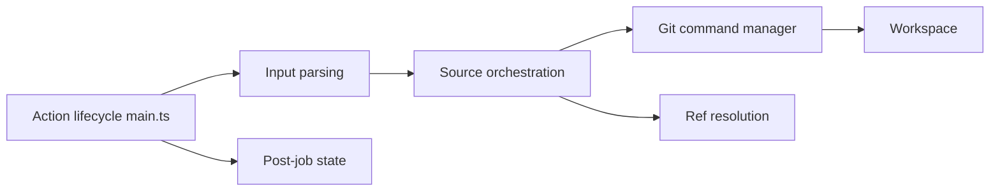

# actions/checkout

> GitHub Action that fetches your repo into the workspace of a CI workflow.

## The problem
A GitHub Actions job starts on an empty runner: it needs the code, at the right commit, with the right permissions.

## What it actually does
Fetches a single commit by default (`fetch-depth: 0` for the full history). Options: `ref`, `token`, SSH key, submodules, LFS, sparse checkout, partial clone, multiple repos. Since v6, credentials are stored outside `.git/config`. v7 refuses by default to check out the code of a fork PR under `pull_request_target` or `workflow_run`.

## How it is wired


## Trying it
```yaml
- uses: actions/checkout@v7
  with:
    fetch-depth: 0
```

## Cost and gotchas
Free, MIT, but tied to GitHub Actions. Recommended permissions: `contents: read`. The README states it no longer accepts external contributions.

## What it is not
Not a cache or a deployment tool. `allow-unsafe-pr-checkout: true` opens a "pwn request" risk.

## Alternatives
No alternative named in the README.

## For you
Adopt: standard building block of any MLOps CI on GitHub; just watch the `persist-credentials` choice.
