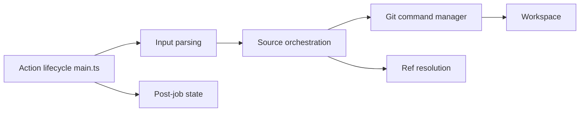

# actions/checkout

> Action GitHub qui récupère ton dépôt dans l'espace de travail d'un workflow CI.

## Le problème
Un job GitHub Actions démarre sur un runner vide : il faut le code, au bon commit, avec les bons droits.

## Ce que ça fait vraiment
Récupère par défaut un seul commit (`fetch-depth: 0` pour tout l'historique). Options : `ref`, `token`, clé SSH, sous-modules, LFS, sparse checkout, clone partiel, plusieurs dépôts. Depuis la v6, les identifiants sont stockés hors de `.git/config`. La v7 refuse par défaut d'extraire le code d'une PR de fork sous `pull_request_target` ou `workflow_run`.

## Comment c'est branché


## Essayer
```yaml
- uses: actions/checkout@v7
  with:
    fetch-depth: 0
```

## Coût et pièges
Gratuit, MIT, mais lié à GitHub Actions. Permissions recommandées : `contents: read`. Le README indique qu'il n'accepte plus de contributions externes.

## Ce que ce n'est pas
Pas un cache ni un outil de déploiement. `allow-unsafe-pr-checkout: true` ouvre un risque de « pwn request ».

## Alternatives
Aucune alternative nommée dans le README.

## Pour toi
Adopter : brique standard de toute CI MLOps sur GitHub ; veille seulement le choix `persist-credentials`.

