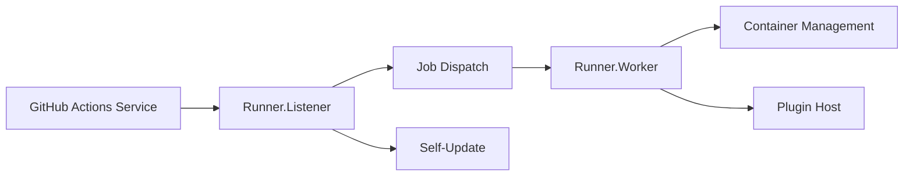

# actions/runner

> Agent that runs the jobs of a GitHub Actions workflow, hosted by GitHub or self-hosted.

## The problem
GitHub-hosted runners are not suitable when you need specific hardware, a private network or cost control.

## What it actually does
The runner receives a job from the GitHub Actions service and executes it. According to the code: a listener (`Runner.Listener`) handles messages, dispatch and self-update; a worker (`Runner.Worker`) runs steps and actions, including in a Docker container; a plugin host handles repository and artifacts. The README announces that GitHub no longer accepts contributions.

## How it is wired

## Trying it
No command in the README: refers to the "Adding self-hosted runners" documentation.

## Cost and gotchas
The software is free, but you pay for the machine that hosts it. A GitHub account is required. Contributions are closed; only security updates are promised.

## What it is not
Not a standalone CI tool: it depends on the GitHub Actions service.

## Alternatives
No alternative named in the README.

## For you
Adopt if your MLOps CI/CD needs GPUs or internal data: it is the official way to move off hosted runners.
