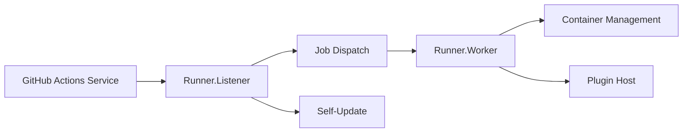

# actions/runner

> Agent qui exécute les jobs d'un workflow GitHub Actions, hébergé par GitHub ou auto-hébergé.

## Le problème
Les runners hébergés par GitHub ne conviennent pas quand il faut du matériel spécifique, un réseau privé ou un contrôle des coûts.

## Ce que ça fait vraiment
Le runner reçoit un job du service GitHub Actions et l'exécute. D'après le code : un listener (`Runner.Listener`) gère messages, dispatch et auto-mise à jour ; un worker (`Runner.Worker`) exécute étapes et actions, y compris en conteneur Docker ; un hôte de plugins traite dépôt et artefacts. Le README annonce que GitHub n'accepte plus de contributions.

## Comment c'est branché

## Essayer
Aucune commande dans le README : renvoi vers la documentation « Adding self-hosted runners ».

## Coût et pièges
Logiciel gratuit, mais tu paies la machine qui l'héberge. Compte GitHub nécessaire. Contributions fermées ; seules les mises à jour de sécurité sont promises.

## Ce que ce n'est pas
Pas un outil de CI autonome : il dépend du service GitHub Actions.

## Alternatives
Aucune alternative nommée dans le README.

## Pour toi
À adopter si ta CI/CD MLOps a besoin de GPU ou de données internes : c'est la voie officielle pour sortir des runners hébergés.

