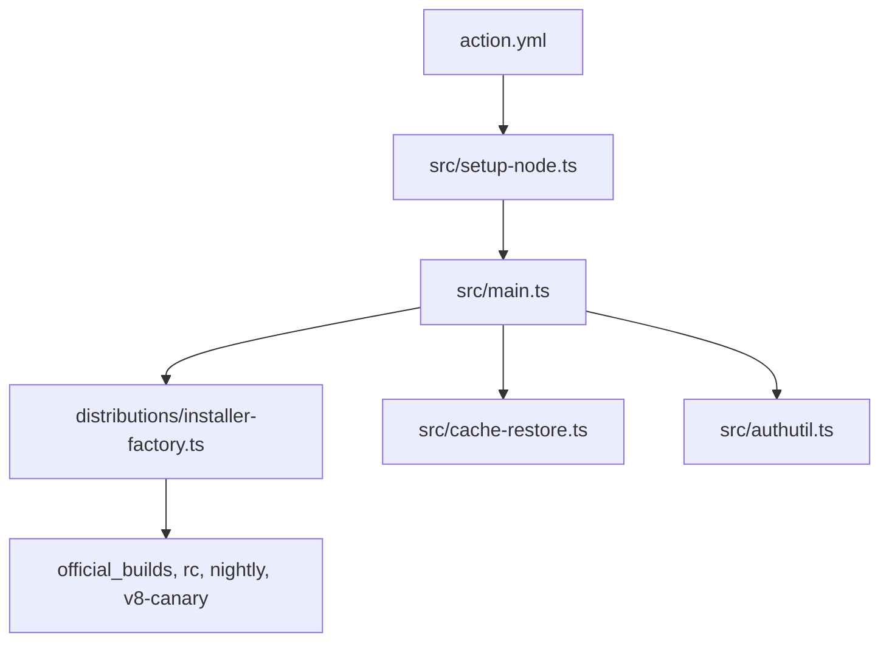

# actions/setup-node

> GitHub Action that installs a Node.js version, caches dependencies and configures npm authentication.

## The problem
Every CI workflow has to install the right Node version, cache packages and configure the registry.

## What it actually does
The action downloads and caches a Node version (official, rc, nightly or V8 canary), adds it to the PATH, enables the npm, yarn or pnpm cache, registers problem matchers and configures access to npm or GitHub Packages. Version 7 moves to ESM; it removes the dummy `NODE_AUTH_TOKEN` token.

## How it is wired


## Trying it
```bash
# Fichier de workflow (.github/workflows), extrait du README
# - uses: actions/checkout@v7
# - uses: actions/setup-node@v7
#   with:
#     node-version: 24
#     package-manager-cache: false
# - run: npm ci
# - run: npm test
```

## Cost and gotchas
Free (MIT), on GitHub Actions. The cache is enabled by default for npm if `packageManager` is declared: disable it in sensitive workflows. On GHES, the unauthenticated API request limit is 60 per hour.

## What it is not
Not a version manager for a local machine. The cache does not cover `node_modules`.

## Alternatives
No alternative cited in the README.

## For you
Adopt if your CI (front-end tools, documentation, MLOps) uses Node: official action, simple and maintained.
