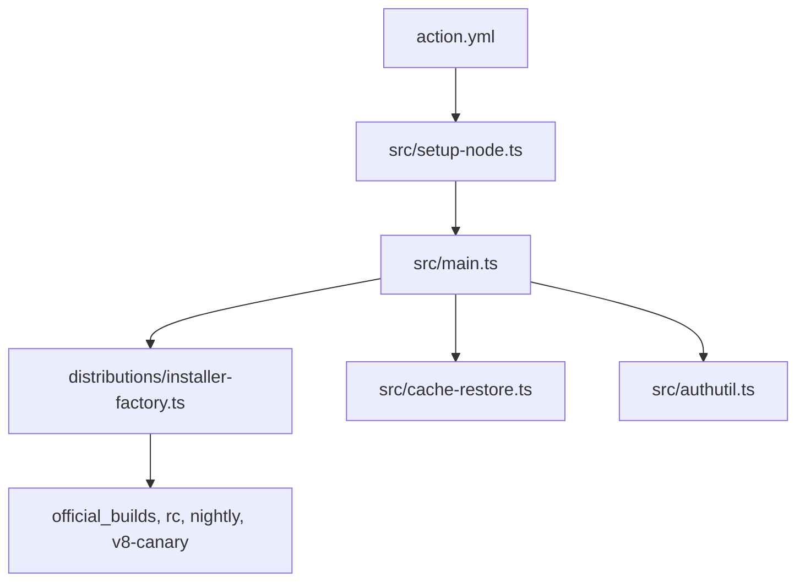

# actions/setup-node

> Action GitHub qui installe une version de Node.js, met en cache les dépendances et configure l'authentification npm.

## Le problème
Chaque workflow CI doit installer la bonne version de Node, cacher les paquets et configurer le registre.

## Ce que ça fait vraiment
L'action télécharge et met en cache une version de Node (officielle, rc, nightly ou canary V8), l'ajoute au PATH, active le cache npm, yarn ou pnpm, enregistre des problem matchers et configure l'accès à npm ou GitHub Packages. La version 7 passe en ESM ; elle supprime le jeton factice `NODE_AUTH_TOKEN`.

## Comment c'est branché


## Essayer
```bash
# Fichier de workflow (.github/workflows), extrait du README
# - uses: actions/checkout@v7
# - uses: actions/setup-node@v7
#   with:
#     node-version: 24
#     package-manager-cache: false
# - run: npm ci
# - run: npm test
```

## Coût et pièges
Gratuit (MIT), sur GitHub Actions. Le cache est activé par défaut pour npm si `packageManager` est déclaré : le désactiver dans les workflows sensibles. Sur GHES, la limite de requêtes API non authentifiées est de 60 par heure.

## Ce que ce n'est pas
Pas un gestionnaire de versions pour poste local. Le cache ne couvre pas `node_modules`.

## Alternatives
Aucune alternative citée dans le README.

## Pour toi
À adopter si tes CI (outils front, documentation, MLOps) utilisent Node : action officielle, simple et maintenue.

