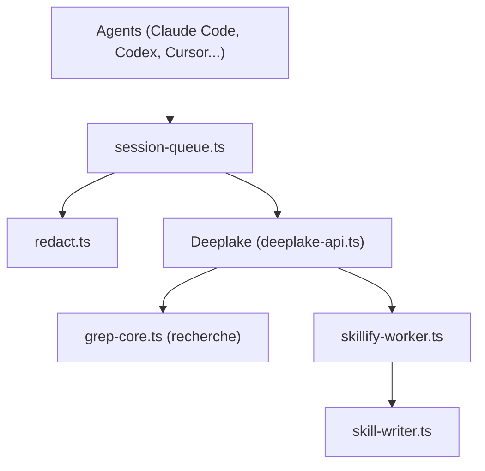

# activeloopai/hivemind

> Shared cloud memory for coding agents, which captures sessions and derives skills from them.

## The problem
What an agent learns one day is lost to the other agents and colleagues, who rediscover the same solutions.

## What it actually does
Hooks, extensions or an MCP server capture prompts, tool calls and responses from Claude Code, Codex, Cursor, OpenClaw, Hermes, pi and Cowork (alpha). The traces go into Deeplake; a lexical search, with an optional semantic one, queries them. At the end of a session, a worker produces summaries and mines recurring patterns to write `SKILL.md` files. It also shares team rules and a code graph.

## How it is wired


## Trying it
```bash
curl -fsSL https://deeplake.ai/hivemind.sh | sh
npm i -g @deeplake/hivemind && hivemind install
hivemind status
```

## Cost and gotchas
A Deeplake account is required. All workspace members can read the traces: full prompts and tool outputs. The workers run `claude -p` or equivalent, so they consume your quota. Can be disabled with `HIVEMIND_CAPTURE=false` or a `.hivemind` file.

## What it is not
Not a local memory: the data leaves your machine, unless stored in your own bucket (BYOC). The announced gain comes from a 100-question LoCoMo benchmark.

## Alternatives
- OpenClaw's memory-core: runs in parallel, Hivemind does not replace it.

## For you
Worth watching: the idea of skills derived from team traces is strong, but full session capture in a SaaS requires a security review.
