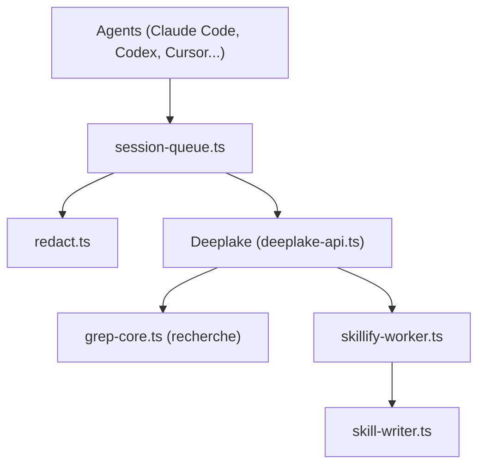

# activeloopai/hivemind

> Mémoire partagée dans le cloud pour agents de code, qui capture les sessions et en tire des skills.

## Le problème
Ce qu'un agent apprend un jour est perdu pour les autres agents et les collègues, qui redécouvrent les mêmes solutions.

## Ce que ça fait vraiment
Des hooks, extensions ou serveur MCP capturent prompts, appels d'outils et réponses de Claude Code, Codex, Cursor, OpenClaw, Hermes, pi et Cowork (alpha). Les traces vont dans Deeplake ; une recherche lexicale, avec option sémantique, les interroge. En fin de session, un worker produit des résumés et mine des motifs récurrents pour écrire des `SKILL.md`. Il partage aussi des règles d'équipe et un graphe du code.

## Comment c'est branché


## Essayer
```bash
curl -fsSL https://deeplake.ai/hivemind.sh | sh
npm i -g @deeplake/hivemind && hivemind install
hivemind status
```

## Coût et pièges
Compte Deeplake requis. Tous les membres de l'espace de travail lisent les traces : prompts et sorties d'outils complets. Les workers lancent `claude -p` ou équivalent, donc consomment ton quota. Désactivable avec `HIVEMIND_CAPTURE=false` ou un fichier `.hivemind`.

## Ce que ce n'est pas
Pas une mémoire locale : les données quittent ta machine, sauf stockage dans ton propre bucket (BYOC). Le gain annoncé vient d'un benchmark LoCoMo de 100 questions.

## Alternatives
- memory-core d'OpenClaw : fonctionne en parallèle, Hivemind ne le remplace pas.

## Pour toi
À surveiller : l'idée de skills issus des traces d'équipe est forte, mais la capture complète des sessions dans un SaaS demande une validation sécurité.

