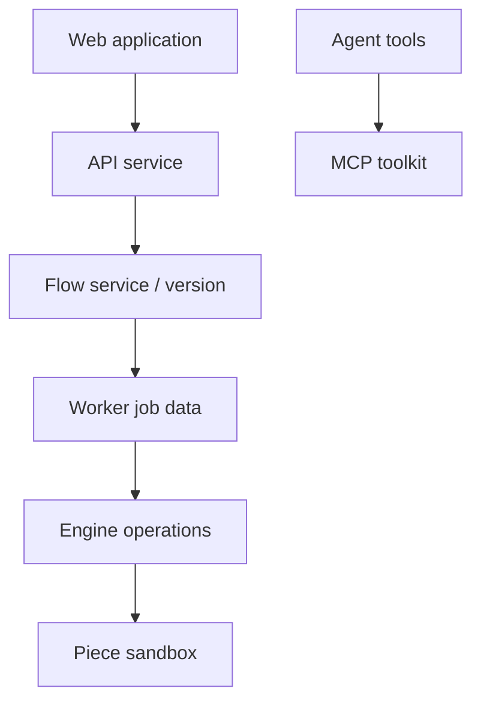

# activepieces/activepieces

> Open-source Zapier-style automation platform, extensible with TypeScript "pieces", with MCP servers.

## The problem
Connecting services (Sheets, OpenAI, Discord...) without writing a script per integration, while keeping control over hosting.

## What it actually does
A versioned flow editor (loops, branches, retries, HTTP, NPM code), plus over 200 npm pieces, 60% of them community-made, exposed as MCP tools, AI pieces and human inputs (form, chat, approval). Self-hostable.

## How it is wired

## Trying it
No command in the provided README: see the installation documentation (activepieces.com/docs/install/overview).

## Cost and gotchas
Self-hosting: infrastructure is at your expense. A license is present but not identified by GitHub: check it before commercial use.

## What it is not
Not a data orchestrator like Airflow: a business-flow automation tool. The enterprise editions are not detailed.

## Alternatives
None named other than Zapier (the one it replaces).

## For you
Worth watching: useful for light automations and MCP tools, with the license to be read first.
