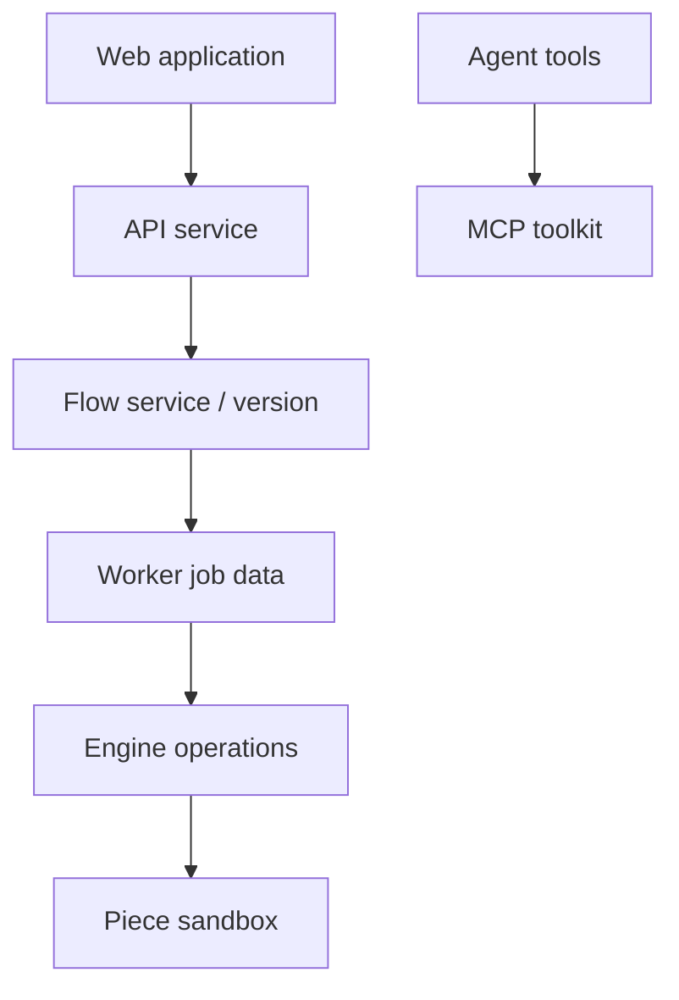

# activepieces/activepieces

> Plateforme d'automatisation open source type Zapier, extensible par des « pieces » TypeScript, avec serveurs MCP.

## Le problème
Relier des services (Sheets, OpenAI, Discord...) sans écrire un script par intégration, en gardant la main sur l'hébergement.

## Ce que ça fait vraiment
Éditeur de flux versionnés (boucles, branches, retries, HTTP, code NPM), plus de 200 pieces npm dont 60 % communautaires, exposées comme outils MCP, pieces IA et entrées humaines (formulaire, chat, approbation). Auto-hébergeable.

## Comment c'est branché

## Essayer
Aucune commande dans le README fourni : voir la documentation d'installation (activepieces.com/docs/install/overview).

## Coût et pièges
Auto-hébergement : infrastructure à ta charge. Licence présente mais non identifiée par GitHub : vérifier avant usage commercial.

## Ce que ce n'est pas
Pas un orchestrateur de données type Airflow : un outil d'automatisation de flux métier. Les édition entreprise ne sont pas détaillées.

## Alternatives
Aucune nommée hors Zapier (le remplacé).

## Pour toi
À surveiller : utile pour des automatisations légères et des outils MCP, avec la licence à lire d'abord.

