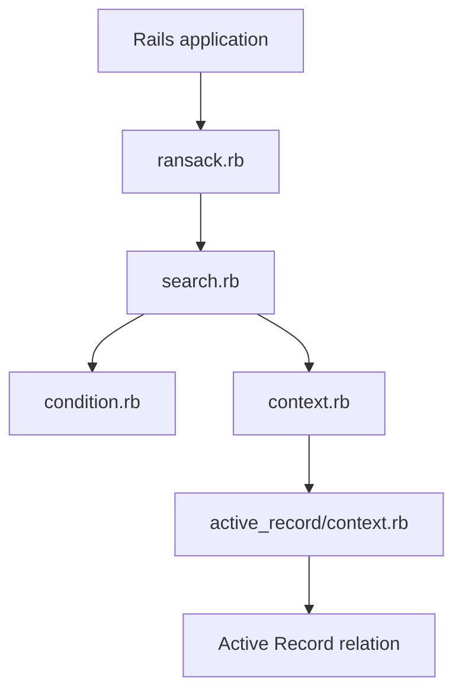

# activerecord-hackery/ransack

> Rails gem that adds search and sorting to an application, without a search server.

## The problem
Hand-writing the search forms, filters and sort links of a Rails application is repetitive.

## What it actually does
From the submitted parameters (`params[:q]`), builds a search tree (conditions, groups, sorts), translates it into an Active Record relation, and provides form helpers (`search_form_for`, `sort_link`). Predicates, custom ransackers and translations are extension points. Supports Rails 8.1, Ruby 3.4+, Postgres, MySQL, Trilogy, SQLite.

## How it is wired


## Trying it
```bash
gem 'ransack'
```
```ruby
@q = Post.ransack(params[:q])
@posts = @q.result
```

## Cost and gotchas
Free. Requires recent Rails and Ruby. The README does not detail the risks of exposing fields; see the authorization section of the documentation.

## What it is not
Not a full-text search engine: it generates SQL queries. Only useful for Rails applications.

## Alternatives
No alternative named in the README.

## For you
Ignore unless you maintain a Rails application: it is not a data or AI tool.
