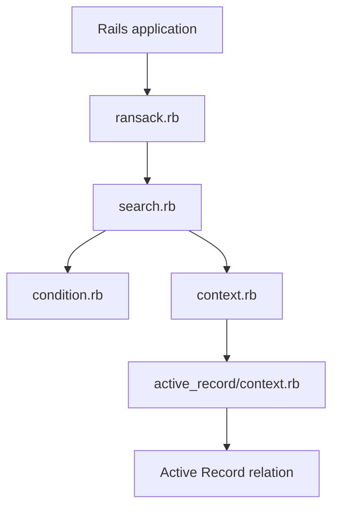

# activerecord-hackery/ransack

> Gem Rails qui ajoute recherche et tri à une application, sans serveur de recherche.

## Le problème
Écrire à la main les formulaires de recherche, filtres et liens de tri d'une application Rails est répétitif.

## Ce que ça fait vraiment
À partir des paramètres envoyés (`params[:q]`), construit un arbre de recherche (conditions, groupes, tris), le traduit en relation Active Record, et fournit des helpers de formulaire (`search_form_for`, `sort_link`). Prédicats, ransackers personnalisés et traductions sont des points d'extension. Supporte Rails 8.1, Ruby 3.4+, Postgres, MySQL, Trilogy, SQLite.

## Comment c'est branché


## Essayer
```bash
gem 'ransack'
```
```ruby
@q = Post.ransack(params[:q])
@posts = @q.result
```

## Coût et pièges
Gratuit. Exige Rails et Ruby récents. Le README ne détaille pas les risques d'exposition de champs ; voir la section autorisation de la documentation.

## Ce que ce n'est pas
Pas un moteur de recherche plein texte : il génère des requêtes SQL. Ne sert qu'aux applications Rails.

## Alternatives
Aucune alternative nommée dans le README.

## Pour toi
À ignorer sauf si tu maintiens une application Rails : ce n'est pas un outil de data ou d'IA.

