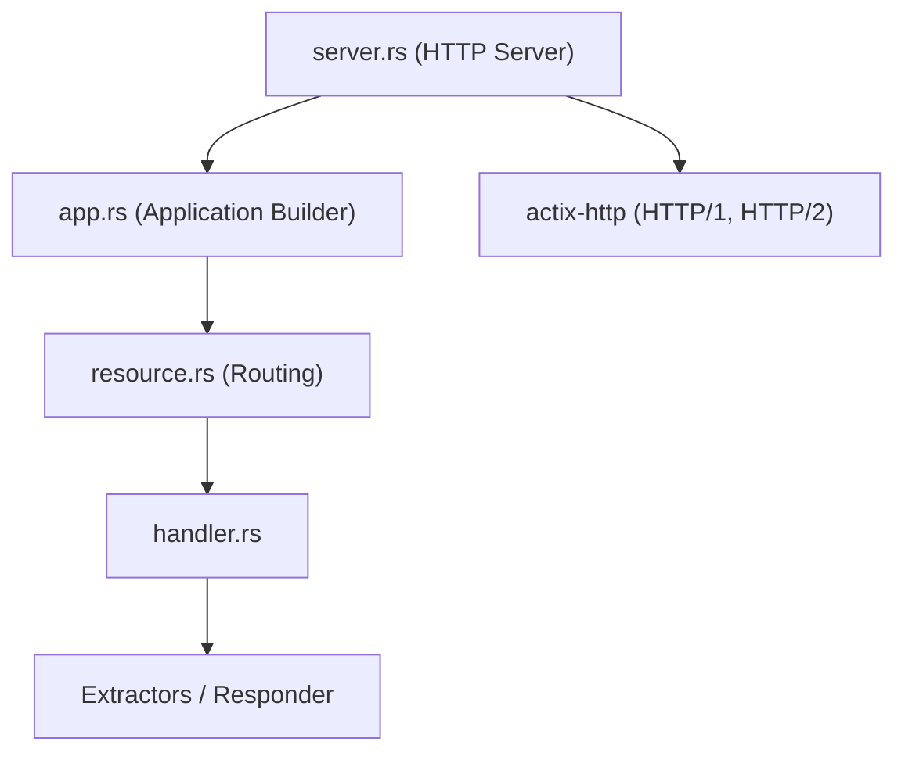

# actix/actix-web

> Rust web framework for writing HTTP servers.

## The problem
Not documented in the README, which contains only its title.

## What it actually does
Based on the architecture described: it accepts HTTP requests, routes them to handlers, extracts data from them and returns responses. The workspace includes HTTP/1 and HTTP/2, middleware, WebSockets, multipart forms, static files and the awc client.

## How it is wired

## Trying it
No documented command: the README provided contains no command.

## Cost and gotchas
Free, Apache-2.0 license. Requires the Rust toolchain (Cargo), which is not listed among the plan's prerequisites.

## What it is not
Minimal sheet: the README provided is almost empty, nothing more than the file name is established. Not a Python framework.

## Alternatives
No alternative named in the README.

## For you
Ignore here: a Rust web framework, only useful if you write services in Rust; the material provided does not allow going further.
