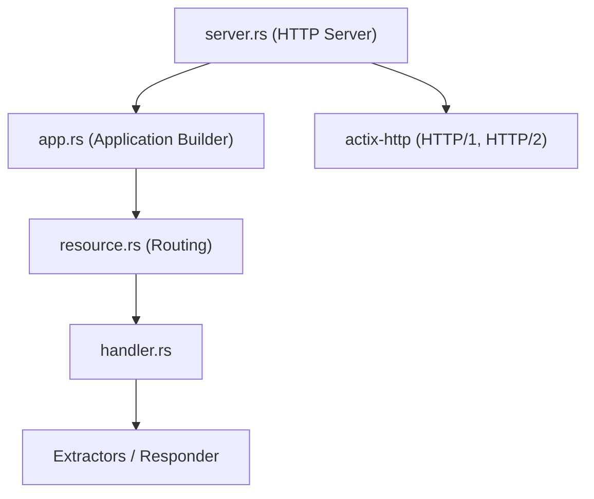

# actix/actix-web

> Framework web en Rust pour écrire des serveurs HTTP.

## Le problème
Non documenté dans le README, qui ne contient que son titre.

## Ce que ça fait vraiment
D'après l'architecture décrite : accepte des requêtes HTTP, les route vers des gestionnaires, en extrait les données et renvoie des réponses. Le workspace inclut HTTP/1 et HTTP/2, des intergiciels, WebSockets, formulaires multipart, fichiers statiques et le client awc.

## Comment c'est branché

## Essayer
Aucune commande documentée : le README fourni ne contient aucune commande.

## Coût et pièges
Gratuit, licence Apache-2.0. Demande la chaîne Rust (Cargo), non listée parmi les prérequis du plan.

## Ce que ce n'est pas
Fiche minimale : le README fourni est quasi vide, rien de plus que le nom du fichier n'est établi. Pas un framework Python.

## Alternatives
Aucune alternative nommée dans le README.

## Pour toi
À ignorer ici : un framework web Rust, utile seulement si tu écris des services de service en Rust ; la matière fournie ne permet pas d'aller plus loin.

