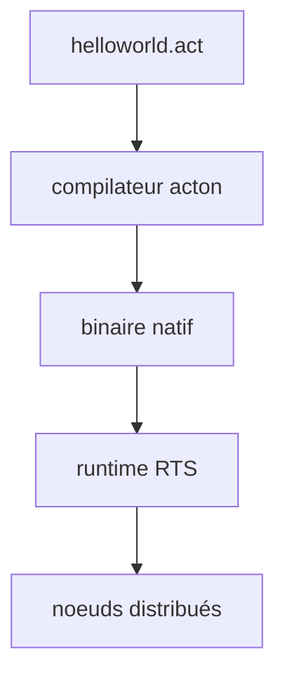

# actonlang/acton

> Compiled actor-based language with Python-like syntax, with distributed execution.

## The problem
Distributed systems require manually handling memory, migration and recovery from failures.

## What it actually does
Statically typed language with type inference, compiled, with garbage collection. The runtime can distribute actors across several machines, with exactly-once delivery and checkpoint recovery in a distributed database. The README declares it experimental.

## How it is wired
Simplified diagram based on the sheet, no diagram provided.


## Trying it
```bash
sudo apt-get install -qy acton
brew install actonlang/acton/acton
acton helloworld.act
./helloworld
```

## Cost and gotchas
Syntax still liable to change. Deployment relies on apt, brew or a Docker image (not required).

## What it is not
Not Python: it is a distinct language that borrows its syntax; no documented data/AI libraries.

## Alternatives
No alternative named.

## For you
Ignore: experimental language with no data/AI ecosystem; Python remains the safer choice.
