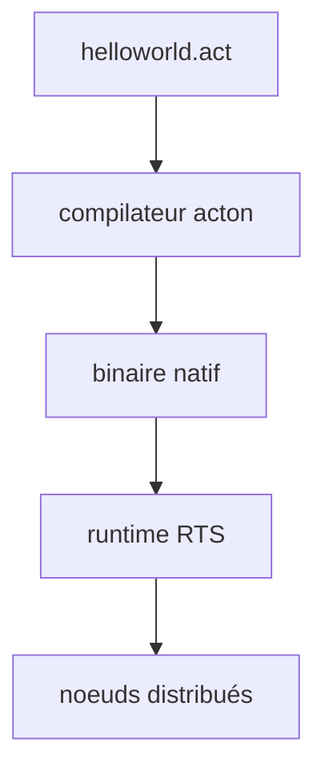

# actonlang/acton

> Langage compilé à acteurs, de syntaxe proche de Python, avec exécution distribuée.

## Le problème
Les systèmes distribués demandent de gérer à la main la mémoire, la migration et la reprise sur panne.

## Ce que ça fait vraiment
Langage statiquement typé à inférence de types, compilé, avec ramasse-miettes. Le runtime peut distribuer des acteurs sur plusieurs machines, avec livraison exactement une fois et reprise par points de contrôle dans une base distribuée. Le README le déclare expérimental.

## Comment c'est branché
Schéma simplifié d'après la fiche, sans diagramme fourni.


## Essayer
```bash
sudo apt-get install -qy acton
brew install actonlang/acton/acton
acton helloworld.act
./helloworld
```

## Coût et pièges
Syntaxe encore susceptible de changer. Le déploiement s'appuie sur apt, brew ou une image Docker (non requis).

## Ce que ce n'est pas
Pas Python : c'est un langage distinct qui en emprunte la syntaxe ; pas de bibliothèques data/IA documentées.

## Alternatives
Aucune alternative nommée.

## Pour toi
À ignorer : langage expérimental sans écosystème data/IA ; Python reste plus sûr.

