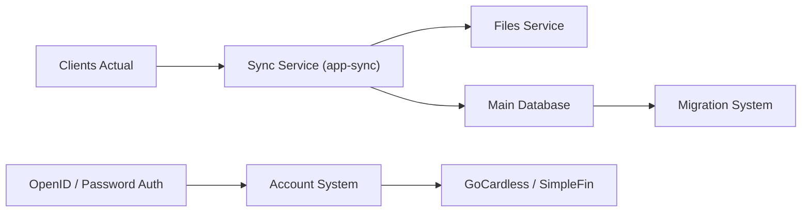

# actualbudget/actual-server

> Former sync server for Actual, a local-first personal finance tool, merged into actualbudget/actual.

## The problem
A local budgeting tool needs a server to sync data between devices.

## What it actually does
The repository provides Actual with a Node.js sync server. From the code: password or OpenID authentication, accounts, file synchronization, database migrations, and GoCardless and SimpleFIN bank connectors. The README notice says the repository merges into `actualbudget/actual` in February 2025.

## How it is wired

## Trying it
No command in the README: it points to the community documentation for installation.

## Cost and gotchas
Free. The GoCardless and SimpleFIN bank connectors go through third-party services. The repository is archived: no more fixes here.

## What it is not
Not the active repository: development continues in `actualbudget/actual`. It is not a cloud app.

## Alternatives
- actualbudget/actual: replacement repository where the project is merged.

## For you
Ignore: archived; better to follow `actualbudget/actual` if local personal finance interests you.
