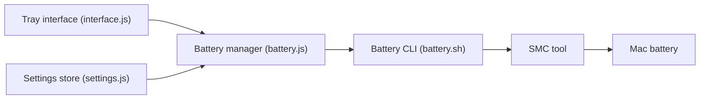

# actuallymentor/battery

> Menu bar app and CLI that limits charging on Apple Silicon MacBooks (e.g. to 80%).

## The problem
Keeping the battery constantly charged at 100% while plugged in wears it out faster.

## What it actually does
Disables charging above a threshold, re-enables it below, and persists after reboot. Uses the `smc` tool. CLI: `maintain`, `charging`, `adapter`, `calibrate`, `charge`, `discharge`, `status`. The GUI app (Electron) handles installing the CLI.

## How it is wired


## Trying it
```bash
brew install battery
curl -s https://raw.githubusercontent.com/actuallymentor/battery/main/setup.sh | bash
battery maintain 80
```

## Cost and gotchas
Free. Administrator password requested at install. Apple Silicon only. Calls external URLs: install analytics (unique IP addresses), icanhazip.com, GitHub, electronjs.org.

## What it is not
Not compatible with Intel. The README points to an article on the real effectiveness of charge capping.

## Alternatives
- Al Dente: free version for Intel Macs, more complete premium version.
- Optimized Charging (macOS): native feature, driven by machine learning.

## For you
Ignore for professional watch: comfort utility for a Mac laptop, with elevated privileges and telemetry.
