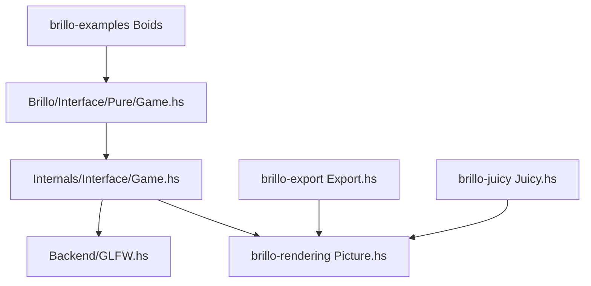

# ad-si/Brillo

> Haskell library for drawing vector graphics and images, an improved fork of gloss.

## The problem
Drawing a simple shape on screen in OpenGL takes a lot of code.

## What it actually does
A Picture data type and a few functions: display, animate, simulate and play for games. Window navigable with keyboard and mouse. Separate packages for rendering, export and Juicy Pixels, plus examples such as Boids.

## How it is wired


## Trying it
```bash
stack run brillo-boids
```
```hs
main = display (InWindow "Nice Window" (200, 200) (10, 10)) white (Circle 80)
```

## Cost and gotchas
Haskell with stack, not in the list of prerequisites. GLFW, GLU and WebP system libraries to install on Linux. No declared license.

## What it is not
Not a data plotting tool like matplotlib: 2D graphics and small games.

## Alternatives
- gloss: the library Brillo is a fork of.

## For you
Ignore: Haskell graphics, with no use for everyday data visualization.
