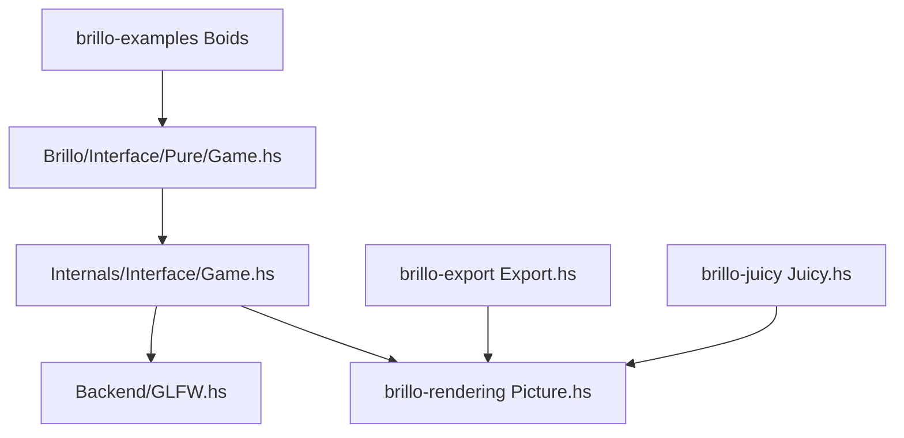

# ad-si/Brillo

> Bibliothèque Haskell pour dessiner des graphiques vectoriels et des images, fork amélioré de gloss.

## Le problème
Dessiner une forme simple à l'écran en OpenGL demande beaucoup de code.

## Ce que ça fait vraiment
Un type de données Picture et quelques fonctions : display, animate, simulate et play pour les jeux. Fenêtre navigable au clavier et à la souris. Paquets séparés pour le rendu, l'export et Juicy Pixels, plus des exemples comme Boids.

## Comment c'est branché


## Essayer
```bash
stack run brillo-boids
```
```hs
main = display (InWindow "Nice Window" (200, 200) (10, 10)) white (Circle 80)
```

## Coût et pièges
Haskell avec stack, pas dans la liste des prérequis. Bibliothèques système GLFW, GLU et WebP à installer sous Linux. Pas de licence déclarée.

## Ce que ce n'est pas
Pas un outil de tracé de données comme matplotlib : de la graphique 2D et des petits jeux.

## Alternatives
- gloss : bibliothèque dont Brillo est un fork.

## Pour toi
Ignorer : de la graphique Haskell, sans usage pour la visualisation de données courante.

