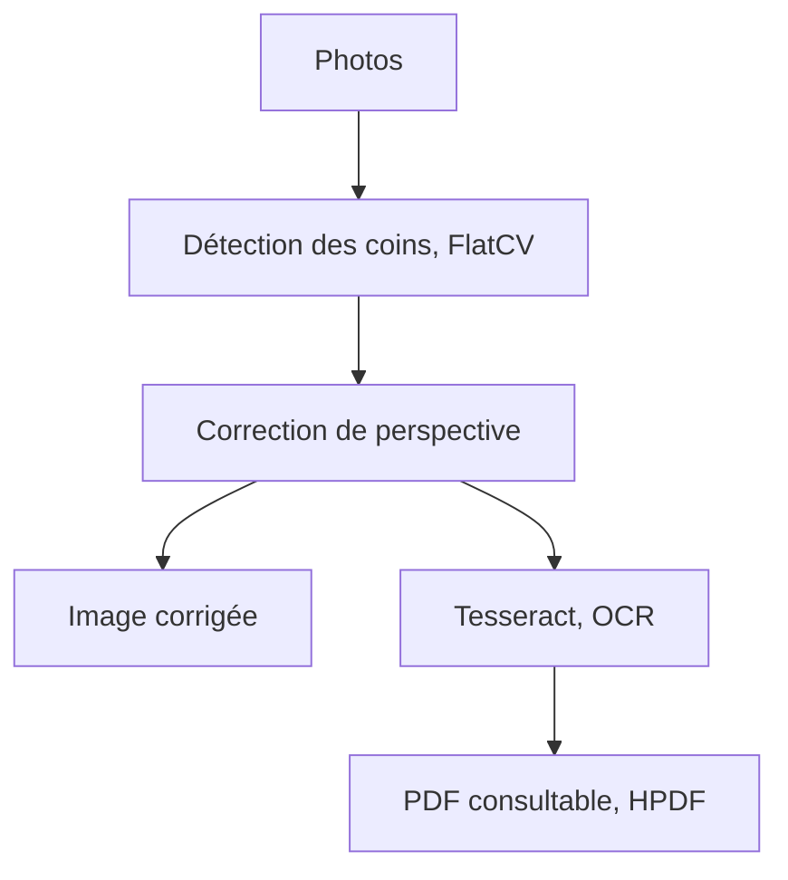

# ad-si/Perspec

> Application that corrects the perspective of photos of whiteboards, documents or facades, with PDF export.

## The problem
A document photo taken at an angle is distorted and hard to read, archive or run through text recognition.

## What it actually does
Automatically detects the four corners of the document (adjustable by hand), straightens the image and saves it in color, grayscale or black and white. The PDF is searchable thanks to Tesseract (English, German, Spanish bundled). A CLI mode processes batches of images. Core in Haskell, vision by FlatCV.

## How it is wired
Simplified diagram based on the sheet, no diagram provided.


## Trying it
```bash
brew install --cask ad-si/tap/perspec
perspec fix image.jpeg
perspec fix photos/*.png
```

## Cost and gotchas
Free. Build from source with Haskell stack (`make install`); on Linux, Nix provides the dependencies. AGPL-3.0 license. The PDF text is limited to Latin characters.

## What it is not
Not a general OCR tool or a creative cropping tool: it straightens flat objects. Prebuilt versions are mostly for macOS.

## Alternatives
No alternative cited in the README (an ad-si/awesome-scanning list is mentioned).

## For you
Watch: useful to prepare clean scans before OCR or when building document datasets, with a scriptable CLI.
