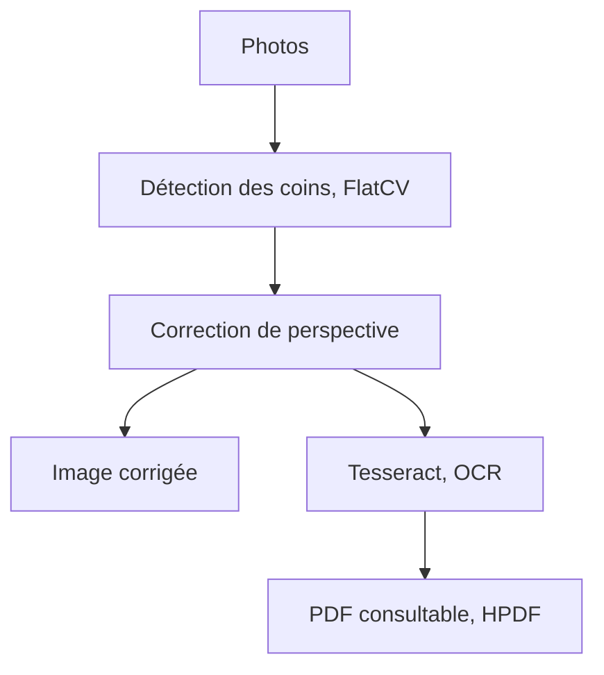

# ad-si/Perspec

> Application qui corrige la perspective de photos de tableaux blancs, documents ou façades, avec export PDF.

## Le problème
Une photo de document prise de biais est déformée et difficile à relire, à archiver ou à passer en reconnaissance de texte.

## Ce que ça fait vraiment
Détecte automatiquement les quatre coins du document (réglables à la main), redresse l'image et l'enregistre en couleur, gris ou noir et blanc. Le PDF est consultable grâce à Tesseract (anglais, allemand, espagnol embarqués). Un mode CLI traite des lots d'images. Cœur en Haskell, vision par FlatCV.

## Comment c'est branché
Schéma simplifié d'après la fiche, sans diagramme fourni.


## Essayer
```bash
brew install --cask ad-si/tap/perspec
perspec fix image.jpeg
perspec fix photos/*.png
```

## Coût et pièges
Gratuit. Compilation depuis les sources avec Haskell stack (`make install`) ; sous Linux, Nix fournit les dépendances. Licence AGPL-3.0. Le texte du PDF est limité aux caractères latins.

## Ce que ce n'est pas
Pas un outil d'OCR général ni de recadrage créatif : il redresse des objets plans. Les versions précompilées sont surtout pour macOS.

## Alternatives
Aucune alternative citée dans le README (une liste ad-si/awesome-scanning est mentionnée).

## Pour toi
Surveiller : utile pour préparer des scans propres avant OCR ou constitution de jeux de documents, avec un CLI scriptable.

