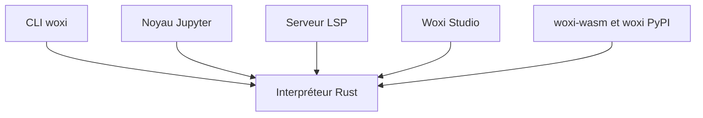

# ad-si/Woxi

> Wolfram language interpreter written in Rust, for command-line scripts and notebooks.

## The problem
WolframScript starts a kernel and checks a license on every launch, which slows scripts down.

## What it actually does
- Runs a subset of the Wolfram language: `woxi eval`, `woxi run`, `woxi repl`.
- Jupyter kernel, LSP server (`woxi lsp`) and the Woxi Studio notebook editor with slideshow mode.
- `woxi-wasm` (npm) and `woxi` (PyPI) packages.
- Command-line tests also validated under WolframScript; `functions.csv` gives the implementation status.

## How it is wired
Simplified diagram based on the sheet, no diagram provided.


## Trying it
```bash
cargo install woxi
woxi eval "1 + 2"
woxi install-kernel
```

## Cost and gotchas
Free. AGPL-3.0 license: be careful if integrating into a service. Building requires Rust; the macOS application is not notarized.

## What it is not
Not a full replacement for Mathematica: only a subset of the language is implemented.

## Alternatives
- WolframScript: the official tool compared in the README, more complete but slower to start.

## For you
Worth watching: useful for running Wolfram without a license in notebooks or in CI, as long as your use fits within the subset.
