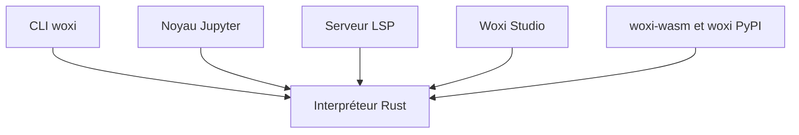

# ad-si/Woxi

> Interpréteur du langage Wolfram écrit en Rust, pour scripts en ligne de commande et notebooks.

## Le problème
WolframScript démarre un noyau et vérifie une licence à chaque lancement, ce qui ralentit les scripts.

## Ce que ça fait vraiment
- Exécute un sous-ensemble du langage Wolfram : `woxi eval`, `woxi run`, `woxi repl`.
- Noyau Jupyter, serveur LSP (`woxi lsp`) et éditeur de notebooks Woxi Studio avec mode diaporama.
- Paquets `woxi-wasm` (npm) et `woxi` (PyPI).
- Tests de ligne de commande validés aussi sous WolframScript ; `functions.csv` donne l'état d'implémentation.

## Comment c'est branché
Schéma simplifié d'après la fiche, sans diagramme fourni.


## Essayer
```bash
cargo install woxi
woxi eval "1 + 2"
woxi install-kernel
```

## Coût et pièges
Gratuit. Licence AGPL-3.0 : attention en cas d'intégration dans un service. Compiler demande Rust ; l'application macOS n'est pas notariée.

## Ce que ce n'est pas
Pas un remplaçant complet de Mathematica : seul un sous-ensemble du langage est implémenté.

## Alternatives
- WolframScript : l'outil officiel comparé dans le README, plus complet mais plus lent à démarrer.

## Pour toi
À surveiller : utile pour exécuter du Wolfram sans licence dans des notebooks ou en CI, tant que ton usage tient dans le sous-ensemble.

