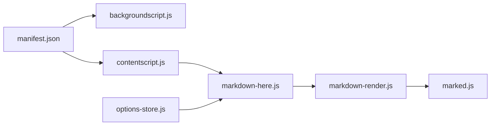

# adam-p/markdown-here

> Browser extension that converts Markdown into rich email before sending.

## The problem
Writing an email with code and formatting in a rich editor is tedious, whereas Markdown is fast.

## What it actually does
The extension (Chrome, Firefox, Opera, Thunderbird) adds a "Markdown Toggle" switch (menu, button or Shift+Alt+M shortcut) that renders the text as HTML with syntax highlighting and TeX formulas, and lets you switch back to Markdown. Local rendering (marked, highlight.js), options synced by the browser.

## How it is wired


## Trying it
```bash
cd utils
node build.js
```

## Cost and gotchas
Free. The last push (2025-08-22) is more than a year old. Mozilla takes up to a month to validate Firefox changes.

## What it is not
It is not a mail client; it depends on the rich editor of webmail services (Gmail, Hotmail, Yahoo, Thunderbird).

## Alternatives
No alternative named in the README.

## For you
Ignore: usage is marginal for a data profile, and the project has not moved in over a year.
