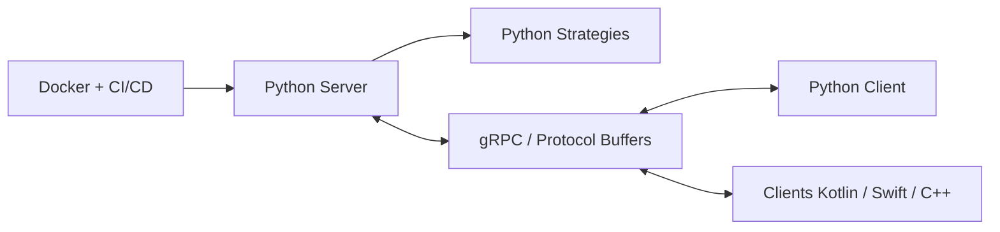

# adap/flower

> ML-framework-agnostic federated learning framework, for researchers and engineers.

## The problem
Training a model on distributed data (hospitals, devices) without centralizing it.

## What it actually does
Flower (`flwr`) orchestrates a server that aggregates client updates according to a strategy (FedAvg, FedProx, FedOpt, etc.). It works with PyTorch, TensorFlow, JAX, scikit-learn, Hugging Face, XGBoost, MLX and others, and offers Python, C/C++, Kotlin and Swift clients. Communication goes through gRPC. Baselines reproduce publications; tutorials and examples cover federated fine-tuning of LLMs.

## How it is wired

## Trying it
The README provides no installation command: it points to the Installation page and the per-framework quickstarts.

## Cost and gotchas
Free. You have to design the clients' network deployment and handle privacy; the privacy tutorials are announced as "coming soon".

## What it is not
Not a privacy guarantee in itself: federated learning is not enough without additional measures (Opacus is mentioned as an example).

## Alternatives
No alternative named in the README.

## For you
Adopt if you work on data that cannot be centralized: active project, broad framework support and many examples.
