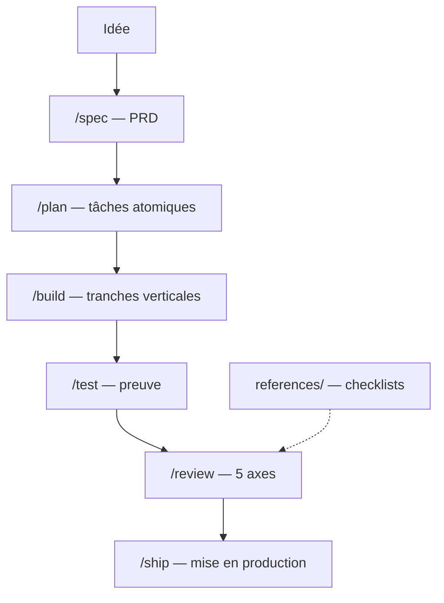

# addyosmani/agent-skills

> Twenty-five Markdown skills that require a developer to follow a disciplined development process.

## The problem
An agent takes the shortest route: no speculation, no testing, no security review.
Reminding the method at each step is not sustainable for the duration of a project.

## What it actually does
Nine distinct phases, each with its own workflow: `/spec`, `/plan`, `/build`, `/test`, `/constraints`, `/review`, `/webperf`, `/code-simplify`, `/ship`.
Each phase has the same structure: a defined process, a table for identifying potential issues, red flags, and evidence requirements.
Four review personas (code, tests, security, web performance) and seven shared checklists.
`/build auto` combines planning and implementation in a single, approved step, committing tasks one at a time.

## How it is wired


## Trying it
```bash
npx skills add addyosmani/agent-skills --list
npx skills add addyosmani/agent-skills
npx skills add addyosmani/agent-skills --skill code-review-and-quality
```

## Cost and gotchas
Free, pure Markdown. The skills require ongoing context and consume tokens with each turn.

Installing a single skill does not copy the `references/` directory, so shared checklists are missing (issue #361).

## What it is not
Not a tool: nothing executes, nothing verifies – these are instructions that the agent can ignore.
Not specific to a language or data; the test examples are JavaScript/TypeScript.
The Claude Code marketplace clones via SSH, which breaks without a configured key.

## Alternatives
- `github/spec-kit`: Same intention, but more prescriptive, with artifacts stored on disk.
- `DietrichGebert/ponytail`: A single rule, with significantly less context consumed.

## For you
This is the most straightforward pack of the lot, and you could choose just two or three skills from it. It's best to purchase it individually.
