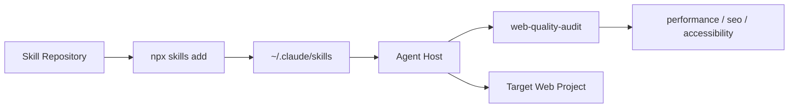

# addyosmani/web-quality-skills

> Collection of agent skills to audit and optimize a website's performance, accessibility and SEO.

## The problem
Asking an agent to "optimize a site" yields generic advice, without measurement or any distinction between field and lab data.

## What it actually does
Six Markdown skills (`web-quality-audit`, `performance`, `core-web-vitals`, `accessibility`, `seo`, `best-practices`) that the agent loads according to trigger phrases. The audit orchestrates the others. When Chrome DevTools MCP is available, it runs Lighthouse and traces; otherwise it falls back to Lighthouse CLI or static inspection. An optional `analyze.sh` script exists.

## How it is wired


## Trying it
```bash
npx skills add addyosmani/web-quality-skills
```
```bash
cp -r skills/* ~/.claude/skills/
```
```text
/plugin marketplace add addyosmani/web-quality-skills
/plugin install web-quality-skills@addy-web-quality-skills
```

## Cost and gotchas
Free. The result depends on the availability of Chrome DevTools MCP; without it, the audit remains more theoretical.

## What it is not
Not an executable tool: these are instructions interpreted by the agent. The README states that the thresholds are initial guardrails and that a score proves neither accessibility nor SEO ranking. "Unofficial" project.

## Alternatives
- Lighthouse CLI and PageSpeed Insights/CrUX, cited in the README as fallbacks.

## For you
Worth watching: useful if you ship web frontends, but outside the data/AI core; MIT license, a single maintainer.
