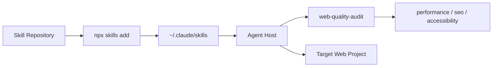

# addyosmani/web-quality-skills

> Collection de skills d'agent pour auditer et optimiser performance, accessibilité et SEO d'un site web.

## Le problème
Demander à un agent d'« optimiser un site » donne des conseils génériques, sans mesure ni distinction entre données terrain et laboratoire.

## Ce que ça fait vraiment
Six skills Markdown (`web-quality-audit`, `performance`, `core-web-vitals`, `accessibility`, `seo`, `best-practices`) que l'agent charge selon les phrases de déclenchement. L'audit orchestre les autres. Quand Chrome DevTools MCP est disponible, il lance Lighthouse et des traces ; sinon repli sur Lighthouse CLI ou inspection statique. Un script optionnel `analyze.sh` existe.

## Comment c'est branché


## Essayer
```bash
npx skills add addyosmani/web-quality-skills
```
```bash
cp -r skills/* ~/.claude/skills/
```
```text
/plugin marketplace add addyosmani/web-quality-skills
/plugin install web-quality-skills@addy-web-quality-skills
```

## Coût et pièges
Gratuit. Le résultat dépend de la disponibilité de Chrome DevTools MCP ; sans lui, l'audit reste plus théorique.

## Ce que ce n'est pas
Pas un outil exécutable : ce sont des instructions interprétées par l'agent. Le README précise que les seuils sont des garde-fous initiaux et qu'un score ne prouve ni l'accessibilité ni le classement SEO. Projet « non officiel ».

## Alternatives
- Lighthouse CLI et PageSpeed Insights/CrUX, cités dans le README comme replis.

## Pour toi
À surveiller : utile si tu livres des fronts web, mais hors du cœur data/IA ; licence MIT, un seul mainteneur.

