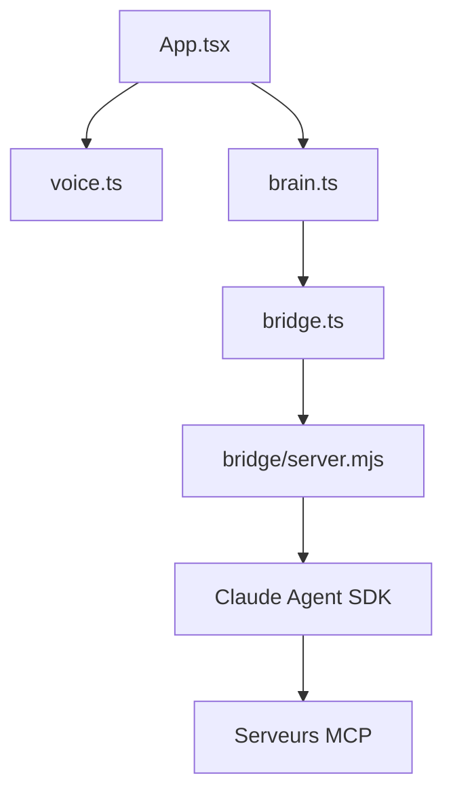

# adewaskar/jarvis

> Browser-based voice assistant with a holographic interface, whose brain is headless Claude Code.

## The problem
A voice assistant that really acts through tools requires wiring together voice, interface and a local agent.

## What it actually does
- "Hey Jarvis" wake word, local voice detection and interruption by speaking.
- A Node bridge (`bridge/server.mjs`) launches the Claude Agent SDK, which drives your MCP servers.
- Three.js and GLSL interface, sanitized HUD panels, `ui_*` tools that the assistant controls by voice.
- ElevenLabs voice and transcription optional; otherwise browser voice.

## How it is wired


## Trying it
```bash
npm install
npm start
npm run bridge:writes
```

## Cost and gotchas
A Claude Code subscription is required (billed to your account). Chrome or Edge in a real window for the microphone. Read-only mode is the default; enabling writes gives the agent a shell and requires reading `decideTool()`.

## What it is not
Not independent of Anthropic: the model runs at Anthropic. Enabling writes can modify your files.

## Alternatives
No named alternative in the README.

## For you
Worth watching: a good example of a Claude Code agent driven as a library with a tool guardrail; fun, but keep it read-only.
