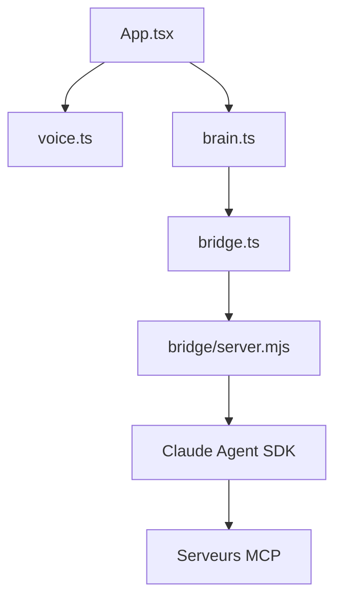

# adewaskar/jarvis

> Assistant vocal dans le navigateur avec interface holographique, dont le cerveau est Claude Code sans interface.

## Le problème
Un assistant vocal qui agit réellement via des outils exige de relier voix, interface et agent local.

## Ce que ça fait vraiment
- Mot d'éveil « Hey Jarvis », détection de voix locale et interruption en parlant.
- Un pont Node (`bridge/server.mjs`) lance le Claude Agent SDK, qui pilote tes serveurs MCP.
- Interface Three.js et GLSL, panneaux HUD assainis, outils `ui_*` que l'assistant commande à la voix.
- Voix et transcription ElevenLabs en option ; sinon voix du navigateur.

## Comment c'est branché


## Essayer
```bash
npm install
npm start
npm run bridge:writes
```

## Coût et pièges
Un abonnement Claude Code est requis (facturé sur ton compte). Chrome ou Edge en vraie fenêtre pour le micro. Le mode lecture seule est la valeur par défaut ; les écritures donnent à l'agent un shell et exigent une lecture de `decideTool()`.

## Ce que ce n'est pas
Pas indépendant d'Anthropic : le modèle tourne chez Anthropic. L'activation des écritures peut modifier tes fichiers.

## Alternatives
Aucune alternative nommée dans le README.

## Pour toi
À surveiller : bon exemple d'agent Claude Code piloté en bibliothèque avec garde-fou d'outils ; amusant, mais à garder en lecture seule.

