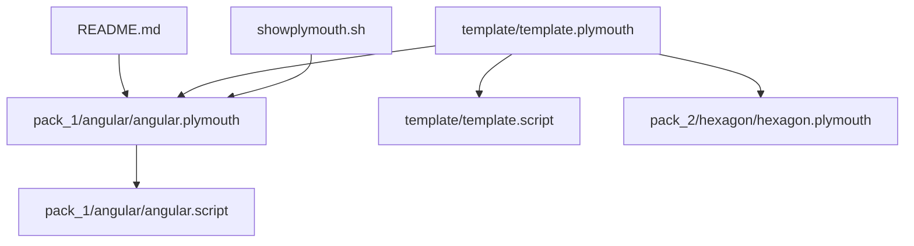

# adi1090x/plymouth-themes

> Collection of eighty Plymouth boot screen themes ported from Android boot animations.

## The problem
Linux's default boot screen is dull; Plymouth lets you change it but few themes are ready to use.

## What it actually does
Four theme packs, each one being a pair of a .plymouth file and a script of the same name, with a starter template. The showplymouth.sh script previews a theme. The README explains copying to the system folder, selection with plymouth-set-default-theme on Arch or update-alternatives on Debian and Ubuntu, and adding a distribution logo.

## How it is wired


## Trying it
```bash
git clone https://github.com/adi1090x/plymouth-themes.git
sudo cp -r angular /usr/share/plymouth/themes/
sudo plymouth-set-default-theme -l
sudo plymouth-set-default-theme -R angular
sudo ./showplymouth.sh 20
```

## Cost and gotchas
Free. Modifies the initramfs: a faulty theme can interfere with the unlock screen of an encrypted disk (on Arch, install cantarell-fonts or ttf-dejavu). Tested at 1366x768 only. Last push in May 2024, GPL-3.0 license.

## What it is not
Not a tool: just graphic resources. Not actively maintained.

## Alternatives
No alternative cited in the README.

## For you
Ignore: Linux boot cosmetics, unrelated to data or AI.
