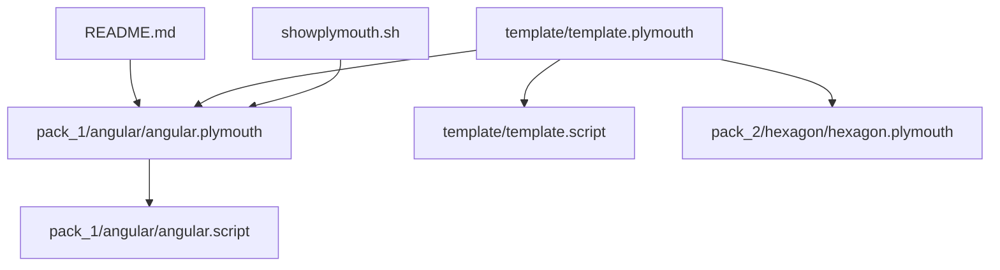

# adi1090x/plymouth-themes

> Collection de quatre-vingts thèmes d'écran de démarrage Plymouth portés depuis des animations de démarrage Android.

## Le problème
L'écran de démarrage par défaut de Linux est terne ; Plymouth permet de le changer mais peu de thèmes sont prêts à l'emploi.

## Ce que ça fait vraiment
Quatre packs de thèmes, chacun étant un couple fichier .plymouth et script de même nom, avec un modèle de départ (template). Le script showplymouth.sh prévisualise un thème. Le README explique la copie vers le dossier système, la sélection par plymouth-set-default-theme sous Arch ou update-alternatives sous Debian et Ubuntu, et l'ajout d'un logo de distribution.

## Comment c'est branché


## Essayer
```bash
git clone https://github.com/adi1090x/plymouth-themes.git
sudo cp -r angular /usr/share/plymouth/themes/
sudo plymouth-set-default-theme -l
sudo plymouth-set-default-theme -R angular
sudo ./showplymouth.sh 20
```

## Coût et pièges
Gratuit. Modifie l'initramfs : un thème défectueux peut gêner l'écran de déverrouillage d'un disque chiffré (sur Arch, installer cantarell-fonts ou ttf-dejavu). Testé en 1366x768 seulement. Dernier push en mai 2024, licence GPL-3.0.

## Ce que ce n'est pas
Pas un outil : de simples ressources graphiques. Pas maintenu activement.

## Alternatives
Aucune alternative citée dans le README.

## Pour toi
Ignorer : cosmétique de démarrage Linux, sans rapport avec la data ou l'IA.

