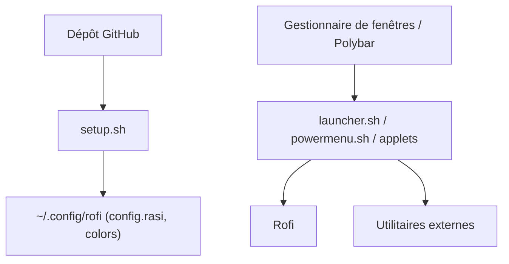

# adi1090x/rofi

> Collection of Rofi themes (launchers, applets, power menus) for Linux users customizing their desktop.

## The problem
Rofi is bare by default; building polished launchers and menus by hand takes time.

## What it actually does
Provides 7 types of launchers, 9 applets (battery, volume, MPD, screenshot…) and 6 types of power menus, with 15 shared color palettes. A `setup.sh` copies the configurations into `~/.config/rofi`. Integration with polybar, i3 and Openbox. Designed for Rofi 1.7.4, 1920x1080 screen.

## How it is wired


## Trying it
```bash
git clone --depth=1 https://github.com/adi1090x/rofi.git
cd rofi
chmod +x setup.sh
./setup.sh
```

## Cost and gotchas
Free. `setup.sh` backs up then replaces your Rofi configuration. Each applet requires its own tools (acpi, maim, mpd…).

## What it is not
Not Rofi itself: version 1.7.4 must be installed separately. The themes are interlinked; modifying them without understanding can break them.

## Alternatives
No alternative named in the README.

## For you
Ignore: Linux desktop customization, no value for a data/AI/MLOps profile.
