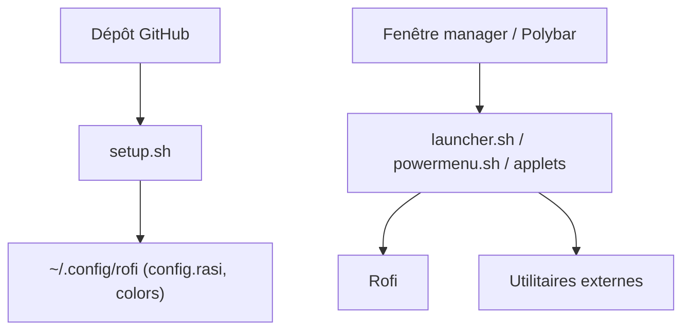

# adi1090x/rofi

> Collection de thèmes Rofi (lanceurs, applets, menus d'extinction) pour utilisateurs Linux personnalisant leur bureau.

## Le problème
Rofi est brut par défaut ; composer des lanceurs et menus soignés à la main prend du temps.

## Ce que ça fait vraiment
Fournit 7 types de lanceurs, 9 applets (batterie, volume, MPD, capture…) et 6 types de menus d'extinction, avec 15 palettes de couleurs partagées. Un `setup.sh` copie les configurations dans `~/.config/rofi`. Intégration avec polybar, i3 et Openbox. Conçu pour Rofi 1.7.4, écran 1920x1080.

## Comment c'est branché


## Essayer
```bash
git clone --depth=1 https://github.com/adi1090x/rofi.git
cd rofi
chmod +x setup.sh
./setup.sh
```

## Coût et pièges
Gratuit. `setup.sh` sauvegarde puis remplace ta configuration Rofi. Chaque applet exige ses outils (acpi, maim, mpd…).

## Ce que ce n'est pas
Pas Rofi lui-même : il faut installer la version 1.7.4 à part. Les thèmes sont liés entre eux ; modifier sans comprendre peut les casser.

## Alternatives
Aucune alternative nommée dans le README.

## Pour toi
Ignorer : personnalisation de bureau Linux, sans valeur pour un profil data/IA/MLOps.

