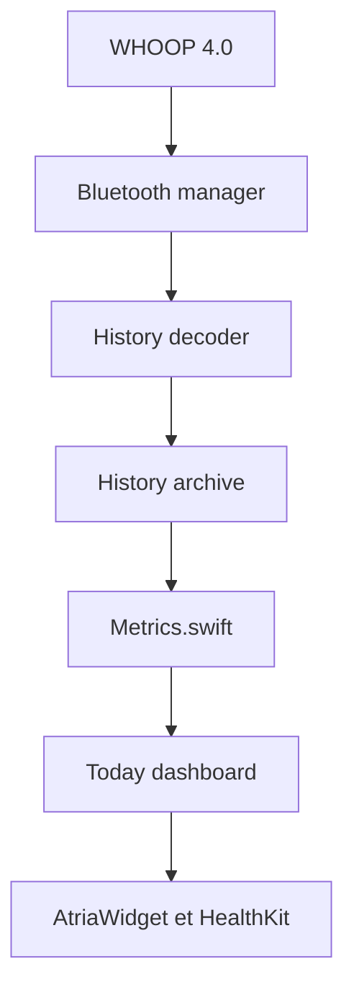

# adidshaft/atria

> Open-source iOS app that reads a WHOOP strap locally over Bluetooth, with no account or cloud.

## The problem
An unused WHOOP strap is only worth something with the official subscription and cloud.

## What it actually does
It collects heart rate, battery and RR intervals over BLE, decodes the strap's history and computes locally HRV, recovery, strain and sleep and workout candidates. It exports to HealthKit and offers a widget. Figures are labeled "personal baseline, unverified"; no reliable daily steps, SpO₂ or absolute temperature.

## How it is wired


## Trying it
```sh
open Atria/Atria.xcodeproj
./live_device_debug.sh --seconds 45 --log logs/live-device/run.log --log-gate-status --standard-hr-only --long-wear-mode --leave-running
./test_handoff_local.sh
```

## Cost and gotchas
A Mac with Xcode, a physical iPhone (the simulator is not enough), a compatible strap and an Apple Developer signature. Logs may contain personal health data.

## What it is not
Not medical software, not affiliated with WHOOP, and it does not bypass the paid cloud features. HRV and recovery are not clinically validated.

## Alternatives
No alternative named in the README.

## For you
Ignore: hardware tinkering project for a specific strap; only the honest handling of RR signals may inspire, it has no MLOps use.
