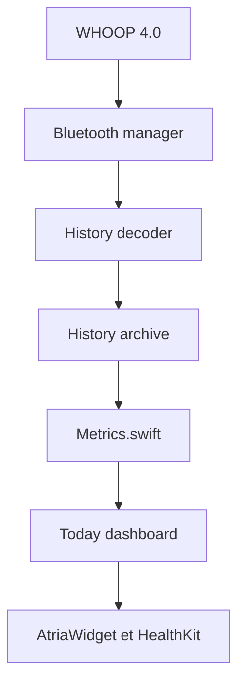

# adidshaft/atria

> Application iOS libre qui lit localement une sangle WHOOP par Bluetooth, sans compte ni cloud.

## Le problème
Une sangle WHOOP inutilisée n'a de valeur qu'avec l'abonnement et le cloud officiels.

## Ce que ça fait vraiment
Elle collecte fréquence cardiaque, batterie et intervalles RR en BLE, décode l'historique de la sangle et calcule localement HRV, récupération, effort et candidats de sommeil et d'entraînement. Elle exporte vers HealthKit et propose un widget. Les chiffres sont étiquetés « base personnelle, non vérifiée » ; pas de pas quotidiens, de SpO₂ ni de température absolue fiables.

## Comment c'est branché


## Essayer
```sh
open Atria/Atria.xcodeproj
./live_device_debug.sh --seconds 45 --log logs/live-device/run.log --log-gate-status --standard-hr-only --long-wear-mode --leave-running
./test_handoff_local.sh
```

## Coût et pièges
Mac avec Xcode, un iPhone physique (le simulateur ne suffit pas), une sangle compatible et une signature Apple Developer. Les logs peuvent contenir des données de santé personnelles.

## Ce que ce n'est pas
Pas un logiciel médical, pas affilié à WHOOP, et il ne contourne pas les fonctions payantes du cloud. HRV et récupération ne sont pas validées cliniquement.

## Alternatives
Aucune alternative nommée dans le README.

## Pour toi
À ignorer : projet de bricolage matériel pour une sangle précise ; seul le traitement honnête des signaux RR peut inspirer, il n'a pas d'usage MLOps.

