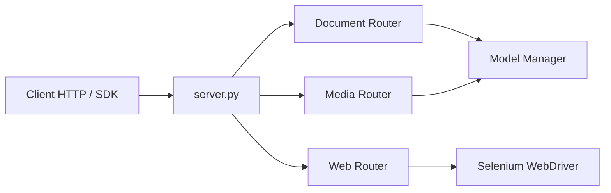

# adithya-s-k/omniparse

> Local server that converts documents, media and web pages into Markdown for LLMs.

## The problem
Preparing PDFs, videos, audio and web pages for RAG requires a different tool for each format.

## What it actually does
A FastAPI API with `/parse_document`, `/parse_media`, `/parse_image`, `/parse_website` routes.
Surya OCR and Florence-2 models for documents, Whisper for audio and video, Selenium for the web.
The `--documents --media --web` flags choose which models are loaded on the GPU.
Everything runs locally, with no database.

## How it is wired


## Trying it
```bash
docker pull savatar101/omniparse:0.1
docker run --gpus all -p 8000:8000 savatar101/omniparse:0.1
python server.py --host 0.0.0.0 --port 8000 --documents --media --web
```

## Cost and gotchas
Needs a GPU with 8 to 10 GB of VRAM, and the server only runs on Linux. The Marker/Surya weights are cc-by-nc-sa, with restrictions above $5M in revenue.

## What it is not
Not reliable on equations, tables or Chinese. The smallest models are used to fit in memory.

## Alternatives
- Marker: the underlying PDF parser, if only PDFs matter.

## For you
Worth watching: the multimodal ingestion API is handy for a RAG proof of concept, but the weight licenses and low accuracy make production use risky.
