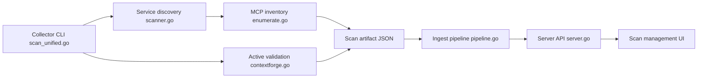

# adithyan-ak/AgentHound

> Offensive security assessment framework for AI agent infrastructure (MCP, A2A, gateways, vector databases), for authorized red teams.

## The problem
Agent infrastructures (MCP servers, model gateways, notebooks, vector stores) accumulate secrets and access that are hard to map. Assessing them by hand is slow.

## What it actually does
A static Go collector inventories local agent configurations (Claude Code, Cursor, etc.), discovers and identifies reachable AI services, tests reuse of the credentials found and writes a checkpointed JSON artifact. It can also validate access through reversible actions. An optional server ingests the artifact, builds a path graph (access, execution, exfiltration, instruction poisoning) and displays it in an interface. The `--stealth` mode is limited to reading.

## How it is wired


## Trying it
Only on systems you own or are authorized to assess.
```bash
brew install adithyan-ak/agenthound/agenthound
agenthound scan --stealth --output scan.json
agenthound revert scan.json
```

## Cost and gotchas
Free; the analysis server requires Docker Compose. The default scan is active (credential reuse, reversible mutation); the artifact contains secrets in clear text and must be protected.

## What it is not
Not a passive scanner: without `--stealth`, it acts on the targets. Use is legally framed by written authorization. Recent project (April 2026), maintained by a single person.

## Alternatives
No alternative named in the README.

## For you
Worth watching: useful for auditing, with authorization, your own MCP deployments and LLM gateways, but young, single-maintainer, and to be used only with `--stealth` on an authorized scope.
