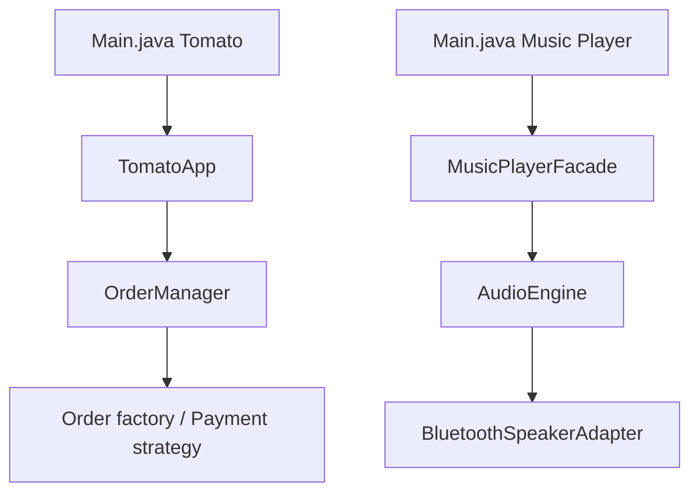

# adityatandon15/Low-Level-Design-Course

> Java and C++ code and notes from a YouTube playlist on Low-Level Design, for learners of object-oriented design.

## The problem
Learning OOP, SOLID and GoF patterns requires compilable examples alongside the video lessons.

## What it actually does
- Teaching repository, not an application: standalone Java and C++ examples, notes and PDFs.
- Starts from OOP/SOLID ("followed" and "violated" versions), then patterns (Strategy, Factory, Observer, Adapter, Proxy).
- Two richer examples: Tomato (food ordering) and Music Player.
- Later exercises: Splitwise, Zepto, Chess, payment gateway.

## How it is wired

## Trying it
No command documented. The README only contains the playlist link (Coder Army); there is no build and no manifest.

## Cost and gotchas
Free, but no license declared: reuse of the code is not covered. No shared build, each file compiles on its own. Minimal README.

## What it is not
Not a library nor a deployable project. The integrations (payment, Bluetooth) are stubs. Content with no direct relation to data or AI.

## Alternatives
None named in the README.

## For you
Ignore: an object design course outside your data / AI / MLOps profile, with no license and inactive since July 2025.
