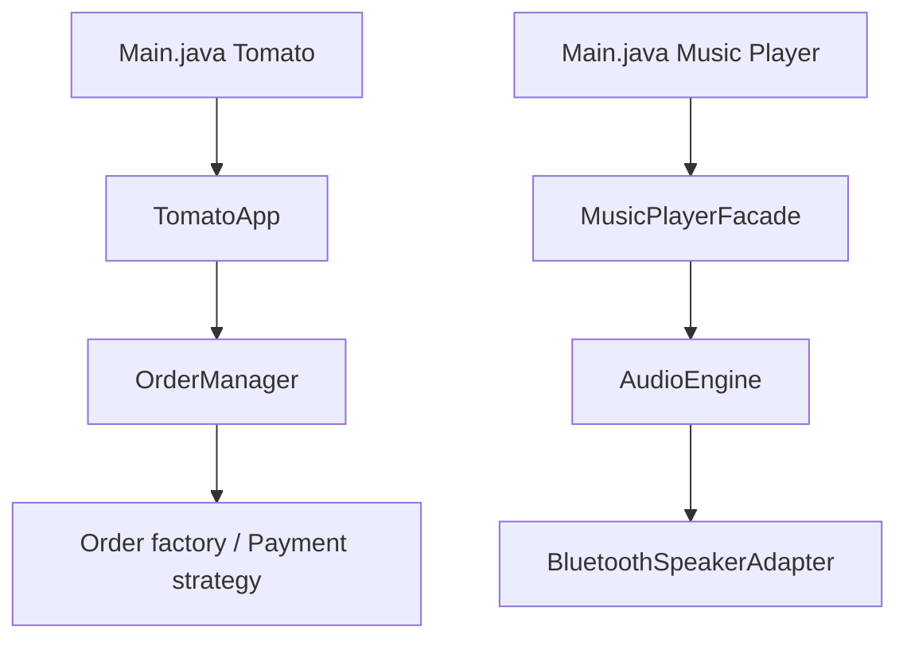

# adityatandon15/Low-Level-Design-Course

> Codes Java et C++ et notes d'une playlist YouTube sur le Low-Level Design, pour apprenants en conception objet.

## Le problème
Apprendre OOP, SOLID et patterns GoF demande des exemples compilables à côté des cours vidéo.

## Ce que ça fait vraiment
- Dépôt pédagogique, pas une application : exemples Java et C++ autonomes, notes et PDF.
- Part d'OOP/SOLID (versions « followed » et « violated »), puis patterns (Strategy, Factory, Observer, Adapter, Proxy).
- Deux exemples plus riches : Tomato (commande de repas) et Music Player.
- Exercices tardifs : Splitwise, Zepto, Chess, passerelle de paiement.

## Comment c'est branché

## Essayer
Aucune commande documentée. Le README ne contient que le lien de la playlist (Coder Army) ; il n'y a ni build ni manifeste.

## Coût et pièges
Gratuit, mais aucune licence déclarée : réutilisation du code non cadrée. Pas de build commun, chaque fichier se compile seul. README minimal.

## Ce que ce n'est pas
Pas une bibliothèque ni un projet déployable. Les intégrations (paiement, Bluetooth) sont des stubs. Contenu sans rapport direct avec la data ou l'IA.

## Alternatives
Aucune nommée dans le README.

## Pour toi
À ignorer : cours de design objet hors de ton profil data / IA / MLOps, sans licence et inactif depuis juillet 2025.

