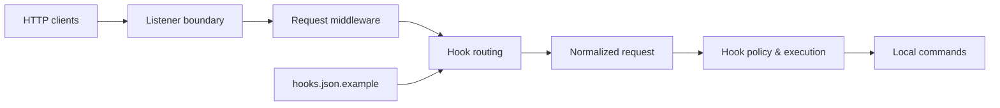

# adnanh/webhook

> Small Go server that exposes HTTP endpoints triggering configured local commands.

## The problem
Triggering a redeploy script on a server at every push or Slack command means writing a small server by hand.

## What it actually does
Reads hooks from JSON/YAML (`hooks.json`), listens on port 9000, and runs the command tied to `/hooks/<id>`.
Passes headers, payload and query as arguments or environment variables; trigger rules (secret, IP, etc.).
Native HTTPS, Unix socket behind a reverse proxy, systemd activation, Go templates, CORS headers.
Logging and request-ID middleware, privilege dropping on Unix.

## How it is wired


## Trying it
```bash
go build github.com/adnanh/webhook
sudo apt-get install webhook
/path/to/webhook -hooks hooks.json -verbose
```

## Cost and gotchas
Free; a hook without a `trigger-rule` lets anyone who knows the URL run your command.
Behind a proxy, the `ip-whitelist` rule sees the proxy's IP.

## What it is not
Not a reliable webhook gateway (queue, replay, monitoring): it receives and executes, nothing more.
Limited multipart support.

## Alternatives
The README points to two unnamed services (script gateway, event gateway): no identifiable repository.

## For you
Adopt it to simply trigger a model retraining or redeploy from a Git push, provided you set a secret rule.
