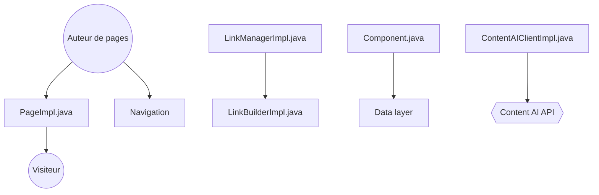

# adobe/aem-core-wcm-components

> Standardized web components for Adobe Experience Manager, aimed at teams building AEM sites.

## The problem
Every AEM site rewrites the same page, navigation and form components.

## What it actually does
About thirty components (page, navigation, text, image, teaser, list, carousel, tabs, forms) with Sling models, an Adobe/Google data layer, JSON output and link handling. A Content AI client and an oEmbed service are also described in the code.

## How it is wired


## Trying it
```bash
mvn clean install -PautoInstallPackage
mvn clean install -PautoInstallPackage,cloud
```

## Cost and gotchas
Free as code, but you need an AEM instance (a licensed Adobe product), Java 8 to 21 and Maven 3.3.9+. The Facebook and Instagram oEmbed integration no longer works without an access token.

## What it is not
Not usable without AEM: these are components for that CMS. Static templates and the classic UI are not supported.

## Alternatives
No alternative cited in the README.

## For you
Ignore: Adobe CMS ecosystem, outside the data, AI or MLOps scope.
