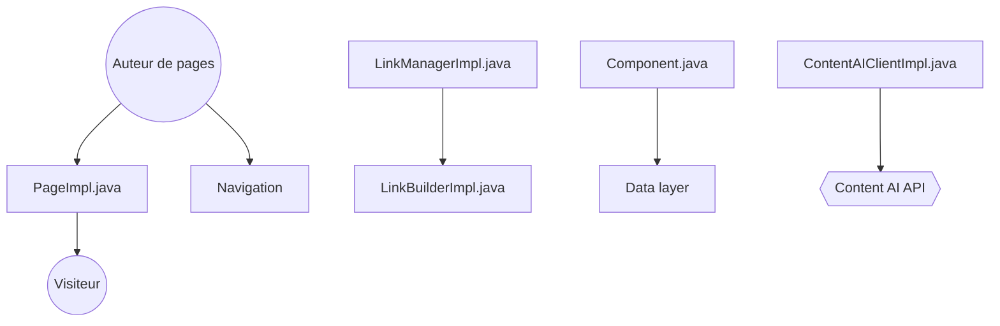

# adobe/aem-core-wcm-components

> Composants web standardisés pour Adobe Experience Manager, destinés aux équipes qui construisent des sites AEM.

## Le problème
Chaque site AEM réécrit les mêmes composants de page, de navigation et de formulaire.

## Ce que ça fait vraiment
Une trentaine de composants (page, navigation, texte, image, teaser, liste, carrousel, onglets, formulaires) avec modèles Sling, couche de données Adobe/Google, sortie JSON et gestion des liens. Un client Content AI et un service oEmbed sont aussi décrits dans le code.

## Comment c'est branché


## Essayer
```bash
mvn clean install -PautoInstallPackage
mvn clean install -PautoInstallPackage,cloud
```

## Coût et pièges
Gratuit en code, mais il faut une instance AEM (produit Adobe sous licence), Java 8 à 21 et Maven 3.3.9+. L'intégration oEmbed Facebook et Instagram ne fonctionne plus sans jeton d'accès.

## Ce que ce n'est pas
Pas utilisable sans AEM : ce sont des composants pour ce CMS. Les modèles statiques et l'interface classique ne sont pas pris en charge.

## Alternatives
Aucune alternative citée dans le README.

## Pour toi
Ignorer : écosystème CMS Adobe, hors périmètre data, IA ou MLOps.

