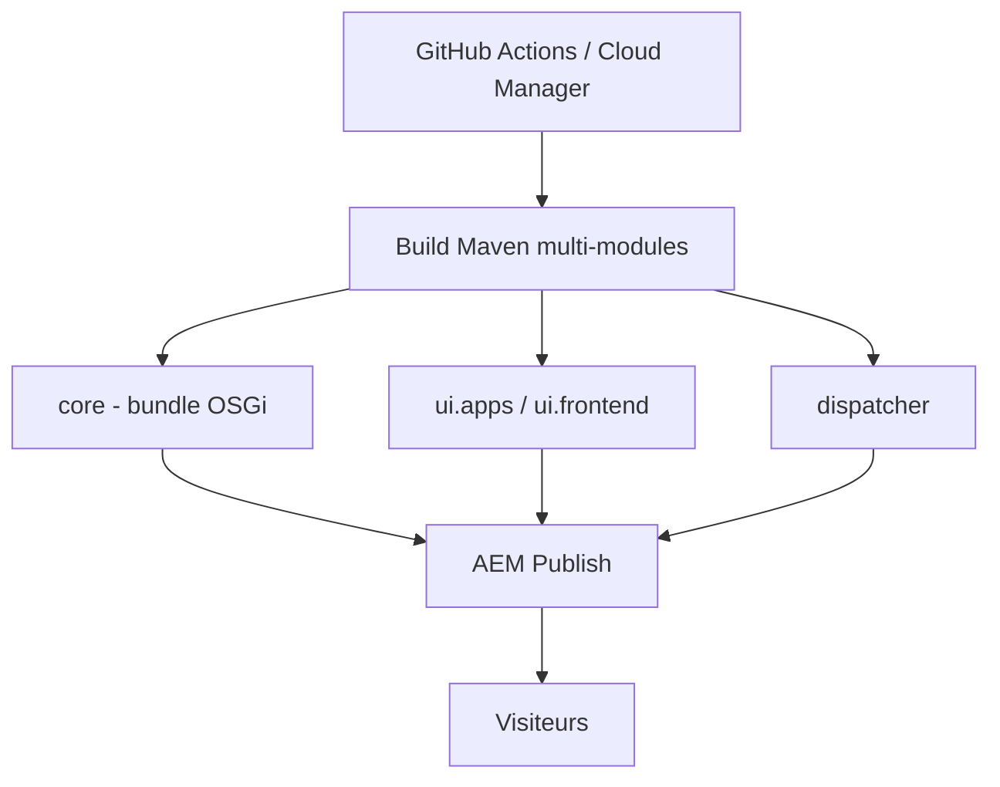

# adobe/aem-guides-wknd

> Adobe Experience Manager reference site for learning how to build a complete site, aimed at AEM developers.

## The problem
Learning AEM Sites requires a complete, realistic project: Java modules, content, front end, Dispatcher cache, tests.

## What it actually does
Multi-module Maven project for a fictional "WKND" brand: OSGi bundles (`core`), HTL definitions and scripts (`ui.apps`), OSGi configs (`ui.config`), sample content (`ui.content.sample`), Webpack/Sass/TypeScript front end (`ui.frontend`), `dispatcher` config, Java integration tests (`it.tests`) and Cypress (`ui.tests`). Deploys via Cloud Manager or locally (AEM SDK, AEM 6.5). Java 21 and Maven 3.9.4+ are required on `main`.

## How it is wired


## Trying it
```bash
cd aem-guides-wknd/
mvn clean install -PautoInstallSinglePackage
# AEM 6.5.x :
mvn clean install -PautoInstallSinglePackage -Pclassic
```

## Cost and gotchas
An AEM instance (Cloud Service, SDK or 6.5) is required, a commercial Adobe product. The sample content overwrites edited content on every build, unless `mode="merge"` is set in `filter.xml`.

## What it is not
Not a template to copy as is: the README says that embedding the full site in the repository is "unusual" and discouraged in a real project. Adobe Stock images cannot be freely reused.

## Alternatives
- AEM Project Archetype: the starting point this project is generated from.
- AEM Core Components: the components it builds on.

## For you
Ignore: it is an Adobe CMS tutorial (Java/OSGi), unrelated to data, AI or MLOps work.
