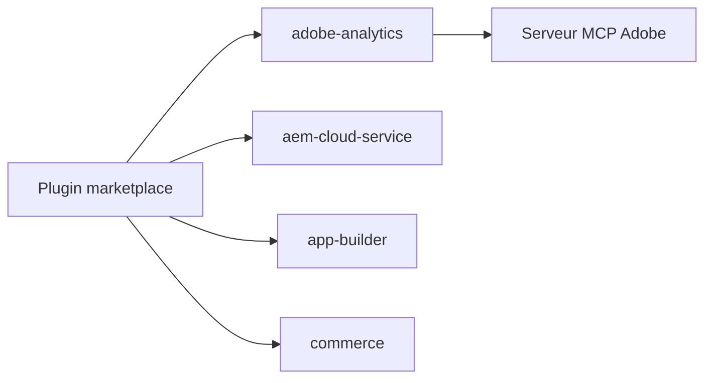

# adobe/skills

> Adobe's catalog of plugins and skills for coding agents: analytics, AEM, Commerce, Workfront.

## The problem
Coding agents know Adobe products (AEM, App Builder, Commerce) and their procedures poorly.

## What it actually does
The repository offers plugins installable in Claude Code, Copilot CLI, Cursor or via `npx skills`. The analytics skills (Adobe Analytics, Customer Journey Analytics) query Adobe MCP servers with IMS authentication: KPIs, top movers, funnels, segment comparison, executive summaries. The rest covers AEM Edge Delivery, AEM Cloud Service and 6.5 LTS, App Builder, Commerce, Workfront and Adobe creative work.

## How it is wired


## Trying it
```bash
/plugin marketplace add adobe/skills
/plugin install adobe-analytics@adobe-skills
npx skills add adobe/skills --all
```

## Cost and gotchas
The analytics skills require Adobe access (IMS headers) and the matching MCP servers. Some skills need the Dispatcher MCP or the `aio` CLI. The Creativity skills only target the Claude desktop app.

## What it is not
Not a general-purpose tool: everything assumes licensed Adobe products. It is not an SDK.

## Alternatives
No alternative named in the README.

## For you
Ignore unless your company uses Adobe Analytics or AEM: the analytics skills are the only data entry point, and require Adobe access.
