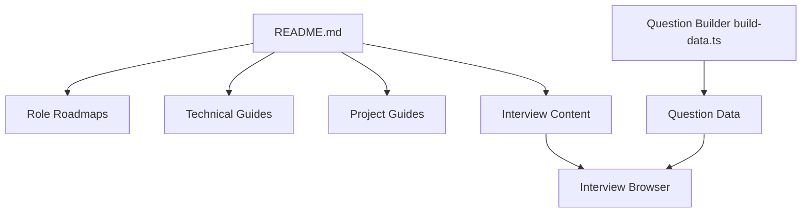

# adongwanai/AgentGuide

> Chinese-language knowledge base for learning AI agents and preparing for a job interview.

## The problem
Resources on agents (loop, memory, MCP, RAG, evaluation) are scattered. Without an ordered path, you know neither what to learn first nor how to present it in an interview.

## What it actually does
It is a repository of Markdown documents, not software. It offers two paths (developer 8-12 weeks, algorithm engineer 10-15 weeks), course modules, a bank of more than 1500 interview questions, and CV tips. Several announced hands-on projects are still "coming soon". The content is mostly in Chinese; the code comes from third-party projects.

## How it is wired


## Trying it
```bash
# README : lecture directe des fichiers du dépôt
docs/01-theory/01-what-is-agent.md
docs/01-theory/04-react-framework.md
```
No installation command is documented.

## Cost and gotchas
Free. The content is in Chinese; the community goes through a WeChat/Xiaohongshu account. The "projects" sections are partly empty.

## What it is not
It is not a library or a framework. It is not an original course: the README says it mostly points to existing resources. No license: reuse is uncertain.

## Alternatives
- hello-agents (Datawhale): complete course on building agents, cited in the README.
- Learn Claude Code: build a mini Claude Code in 12 lessons, cited in the README.

## For you
Keep as a bookmark only if you read Chinese and are preparing for interviews; with no license and no code of its own, it brings nothing to a data/MLOps pipeline.
