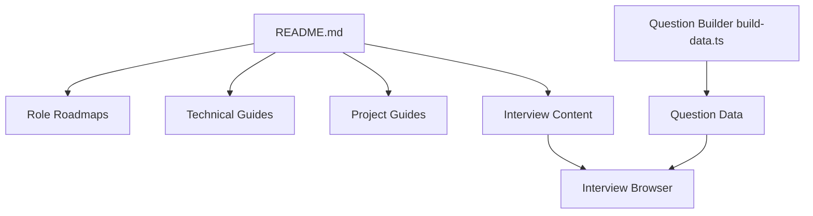

# adongwanai/AgentGuide

> Base de connaissances en chinois pour apprendre les agents IA et préparer un entretien d'embauche.

## Le problème
Les ressources sur les agents (boucle, mémoire, MCP, RAG, évaluation) sont éparses. Sans parcours ordonné, on ne sait ni quoi apprendre d'abord, ni comment le présenter en entretien.

## Ce que ça fait vraiment
C'est un dépôt de documents Markdown, pas un logiciel. Il propose deux parcours (développeur 8-12 semaines, algorithmicien 10-15 semaines), des modules de cours, une banque de plus de 1500 questions d'entretien et des conseils de CV. Plusieurs projets pratiques annoncés sont encore « bientôt disponibles ». Le contenu est surtout en chinois ; le code vient de projets tiers.

## Comment c'est branché


## Essayer
```bash
# README : lecture directe des fichiers du dépôt
docs/01-theory/01-what-is-agent.md
docs/01-theory/04-react-framework.md
```
Aucune commande d'installation n'est documentée.

## Coût et pièges
Gratuit. Le contenu est en chinois ; la communauté passe par un compte WeChat/Xiaohongshu. Les sections « projets » sont en partie vides.

## Ce que ce n'est pas
Ce n'est pas une librairie ni un framework. Ce n'est pas un cours original : le README dit qu'il renvoie surtout vers des ressources existantes. Pas de licence : réutilisation incertaine.

## Alternatives
- hello-agents (Datawhale) : cours complet sur la construction d'agents, cité dans le README.
- Learn Claude Code : construire un mini Claude Code en 12 leçons, cité dans le README.

## Pour toi
À garder en marque-page seulement si tu lis le chinois et prépares des entretiens ; sans licence ni code propre, il n'apporte rien à un pipeline data/MLOps.

