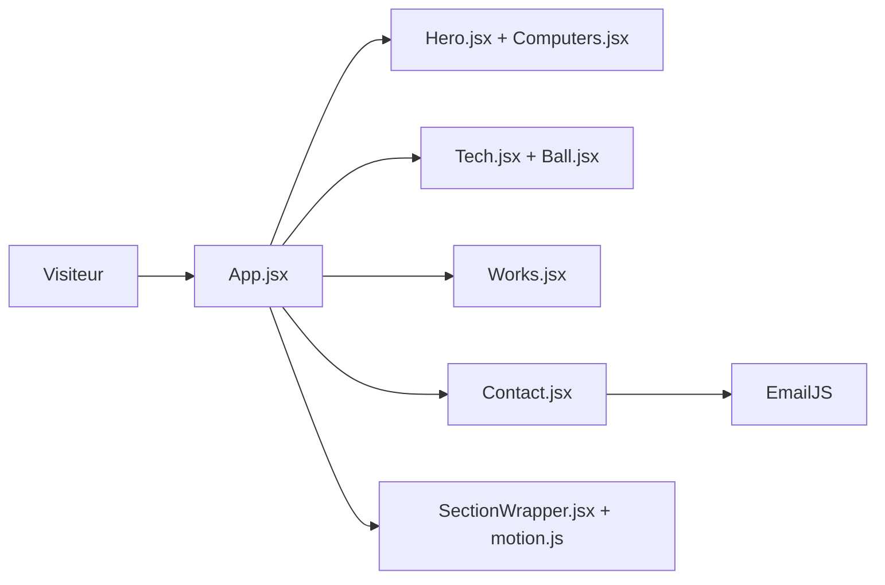

# adrianhajdin/project_3D_developer_portfolio

> React portfolio website template with 3D scenes, code from a video tutorial for web developers.

## The problem
A classic developer portfolio is flat. Starting from scratch to add animated 3D requires mastering Three.js and its React wrappers.

## What it actually does
Single-page React/Vite app with Hero (3D desk), About, Experience, Skills (3D spheres), Works, Feedbacks and Contact (3D earth, starfield background) sections. Animations use framer motion, styling uses Tailwind. The contact form sends through EmailJS. The data (projects, experiences, testimonials) are constants to replace in `constants.js`.

## How it is wired


## Trying it
```bash
git clone git@github.com:adrianhajdin/project_3D_developer_portfolio.git
cd project_3D_developer_portfolio
npm install
# créer .env avec REACT_APP_EMAILJS_USERID, _TEMPLATEID, _RECEIVERID
npm run dev
```

## Cost and gotchas
Free, but you need an EmailJS account for the form. No license is declared: reuse rights are unclear. Last push in October 2024, 124 open issues.

## What it is not
Not a library nor a framework: it is the code of a tutorial to fork and empty out. The supplied content (Starbucks, Tesla, testimonials) is fictional. No link with data or AI.

## Alternatives
No alternative named in the README.

## For you
Ignore: a 3D web template without a license, outside the data/AI/MLOps scope; the only interest is learning React Three Fiber through the tutorial.
