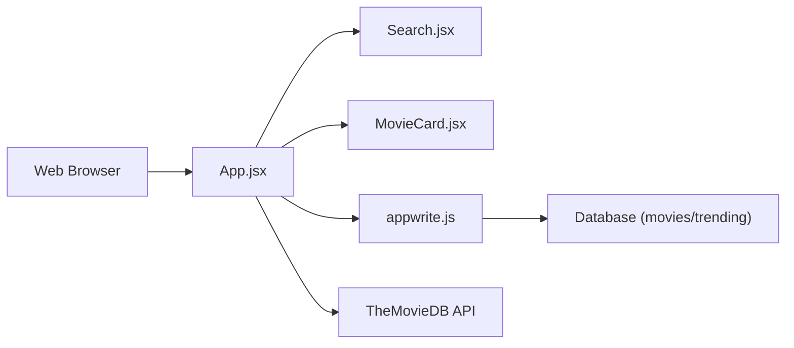

# adrianhajdin/react-movies

> React movie search application from a video tutorial, for front-end beginners.

## The problem
Learning to assemble React, a hosted backend and an external API on a concrete project.

## What it actually does
Vite + React + Tailwind SPA: browse and search movies through the TMDB API, with a "trending" list stored in Appwrite (database). No server in the repository. Components Search, MovieCard, Spinner.

## How it is wired


## Trying it
```bash
git clone https://github.com/adrianhajdin/react-movies.git
cd react-movies
npm install
npm run dev
```
Create `.env.local` with `VITE_TMDB_API_KEY` and the three Appwrite identifiers.

## Cost and gotchas
A TMDB key and an Appwrite project must be created. No license declared: reuse is legally unclear. Last push in June 2025.

## What it is not
Not a product: course material, whose value is in the associated video.

## Alternatives
No alternative named in the README.

## For you
Ignore: front-end exercise with no license, unrelated to data or MLOps.
